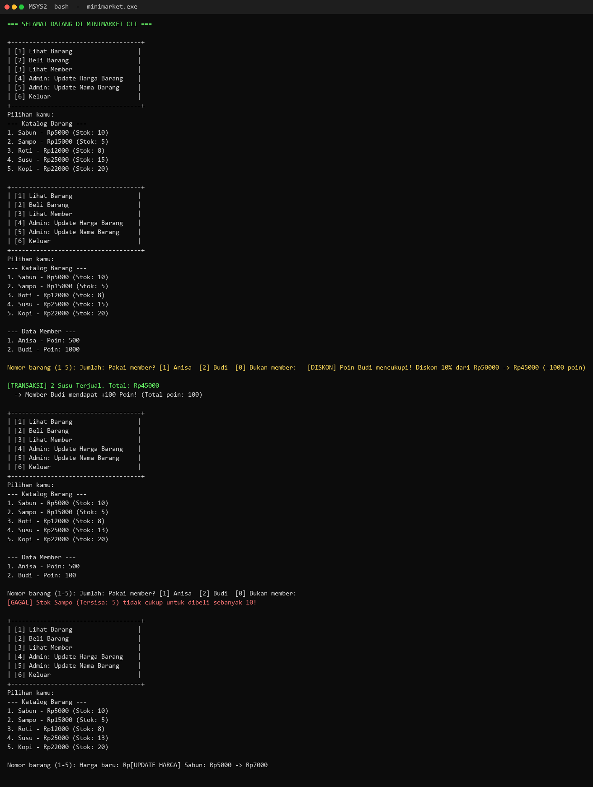
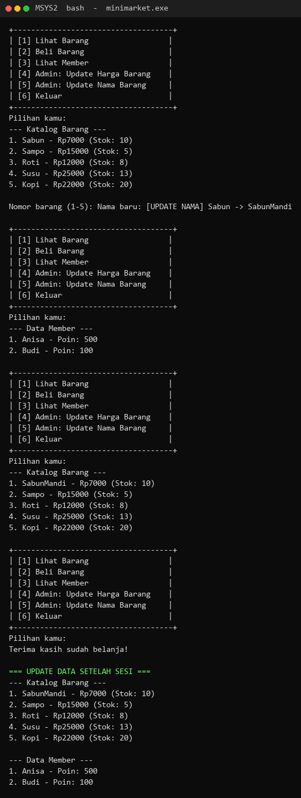

# Mini Project P4 - CLI Minimarket & Membership
**Pointer & Struct (Module P4)**

## 🎯 Tujuan Proyek
Aplikasi CLI minimarket yang mengimplementasikan:
1. **Struct**: Mengelompokkan data barang (`Barang`) dan member (`Member`)
2. **Pointer & Pass by Reference**: Memodifikasi data asli di memori via pointer (`->` operator)
3. **Menu Interaktif**: Loop `while(1)` dengan `switch-case` hingga user memilih "Keluar"

## 🔥 Tantangan Selesai

### ✅ Wajib 1: Update Harga Barang
```c
void updateHarga(Barang *b, int hargaBaru) {
    b->harga = hargaBaru;  // manipulasi langsung via pointer ->
}
```

### ✅ Wajib 2: Update Nama Barang (Typo Fix)
```c
void updateNama(Barang *b, char namaBaru[]) {
    strcpy(b->nama, namaBaru);  // char array tidak bisa pakai =
}
```

### ✅ Wajib 3: Diskon Poin >= 1000 = 10% Off
Dalam fungsi `beliBarang()`:
- Jika member punya poin ≥ 1000 → diskon 10% dari total
- Potong 1000 poin dari member
- Tetap beri +100 poin jika belanja ≥ Rp20.000 (setelah diskon)

### ✅ Bonus: Menu Interaktif (Looping CLI)
- Infinite loop `do-while(pilihan != 6)`
- Menampilkan menu setiap iterasi:
  - `[1] Lihat Barang`
  - `[2] Beli Barang`
  - `[3] Lihat Member`
  - `[4] Admin: Update Harga`
  - `[5] Admin: Update Nama`
  - `[6] Keluar`

## 🖼️ Screenshot Hasil Running

**1. Menu interaktif, transaksi dengan diskon poin (Tantangan 3), stok gagal (mini-challenge 6), dan update harga (Tantangan 1):**



**2. Update nama barang (Tantangan 2), data tersimpan setelah keluar menu, dan data akhir sesi:**



## 💻 Cara Compile & Run

### Di Windows (MSYS2/Git Bash):
```bash
gcc minimarket.c -o minimarket
./minimarket.exe
```

### Di Linux/Mac:
```bash
gcc minimarket.c -o minimarket
./minimarket
```

## 📝 Penjelasan Kode Penting

| Baris | Konsep |
|-------|--------|
| `typedef struct` | Membuat alias tipe data untuk struct agar lebih ringkas |
| `beliBarang(&dbBarang[0], &dbMember[1], qty)` | **Reference operator (`&`)** untuk pass alamat ke parameter pointer |
| `b->stock -= qty` | **Dereference/Arrow operator (`->`)** mengakses/modify data struct lewat pointer |
| `strcpy(b->nama, "X")` | String di C adalah `char[]`, harus pakai `strcpy()` bukan `=` |
| `if (total >= 20000 && m != NULL)` | Cek `NULL` penting karena pembelian tanpa member passed `NULL` |
| `do-while(pilihan != 6)` | Bonus: loop until exit, memastikan program berjalan terus |

## 🏆 Nilai Asistensi
Tantangan wajib (min. 2) diselesaikan: **Nilai Min. 85**  
Semua tantangan wajib + bonus: **Nilai Min. 95**

---
Created with ❤️ by Makhashimas  
Based on: [BP-PA-Assignment P4 Tutorial](https://github.com/anisamsrh/BP-PA-Assignment/tree/main/P4)
